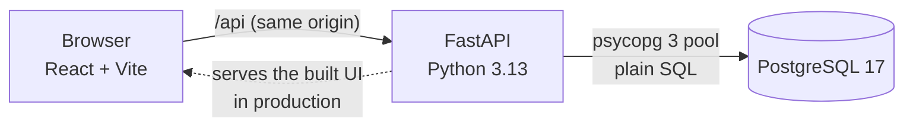

# Tokenized Treasury Transfer & Reconciliation Lab

An independent educational project: a small full-stack app that models how a book-entry security
can be converted into a tokenized form, moved between approved participants, converted back, and
reconciled, without ever creating or losing a unit.

> **Simulation only.** One invented instrument (`DEMO-TREASURY`), synthetic participants and a
> public demo password. No real securities, money, blockchain or DTCC systems are involved: the
> "tokenized" form is a column in PostgreSQL. The design is inspired by public descriptions of
> securities tokenization services; it is not affiliated with DTCC.

## What it does

An operations user can see where the security is held (traditional vs. tokenized units), convert
between the two forms, transfer tokenized units to another approved account, and prove that no
operation created or lost units.

**Demo flow** (the numbers are the seed data):

1. Sign in as `alpha`: 1,000 traditional, 0 tokenized.
2. Convert 100 to tokenized (mint): 900 / 100.
3. Transfer 25 tokenized to `beta`: alpha 900 / 75, beta 1,000 / 25.
4. Convert 10 back to traditional (burn): alpha 910 / 65.
5. Open the history; try a rejected transfer (to the unapproved Delta wallet, or more than you hold);
   resend a request with the same idempotency key and see it replayed, not applied twice.
6. Sign in as `auditor` and run reconciliation: passed, still 3,000 units in total.

**Demo users** (password `demo-password-1` for all, shown on the sign-in screen):

| User | Role | Account |
| --- | --- | --- |
| `alpha`, `beta`, `gamma` | Participant: acts only on their own account | 101, 102, 103 |
| `auditor` | Auditor: reads everything, changes nothing, runs reconciliation | none |

Account 104 (Delta) exists but its wallet is **not approved**, so it can never receive tokenized units.

**Screens:** Holdings, Convert & transfer, History, Reconciliation. Each one handles loading, empty,
validation and server-error states.

## Architecture



- **Development:** Vite serves the UI on :5173 and proxies `/api` to FastAPI on :8000; Postgres runs
  in Docker.
- **Production:** one Docker image. A Node stage builds `client/dist`, and the Python stage serves
  both the API and the built UI from the same origin, so the session cookie needs no CORS setup.
- **No ORM.** Every SQL statement lives in `server/db/**/*.sql` as a named block (`-- name: ...`);
  Python loads them by name and never contains SQL text. Parameters are always sent separately
  (`%(name)s`), never pasted into the SQL.

### Data model

| Table | Purpose |
| --- | --- |
| `accounts` | Participants and their synthetic registered wallet (`is_approved`, deny by default) |
| `assets` | The instrument and its `total_custodied_units` (3,000) |
| `users` | Login identity, bcrypt hash, role; a participant links to exactly one account |
| `positions` | One row per account and asset: `traditional_units` and `tokenized_units`, both `>= 0` |
| `operations` | Every request that changed balances: actor, type, accounts, quantity, idempotency key, request hash, stored result |
| `ledger_entries` | The audit trail: signed unit deltas per account and form; every operation's lines sum to zero or to its opening amount |

Foreign keys, `CHECK` rules (no negative balances, valid roles and types, one shape per operation
type, no self-transfer) and unique keys are enforced by the database itself, not only by the app.

### How a transfer stays correct

One request = one database transaction on one connection:

1. Authenticate (signed session cookie) and authorize (participants only; the source account
   comes from the session, never from the request body).
2. Validate the body (whole units 1 to 1,000,000; unknown fields rejected).
3. Reserve the idempotency key: `INSERT ... ON CONFLICT DO NOTHING` on `(actor, key)`.
   A repeat with the same body replays the stored result (`200`, `Idempotency-Replayed: true`);
   the same key with a different body is a `409`.
4. Lock both position rows with `SELECT ... FOR UPDATE`, always in account-id order, so two
   opposite transfers cannot deadlock.
5. Check the source balance on the locked row, then that both wallets are approved (`422` if not).
6. Debit, credit, write the ledger lines, store the result, `COMMIT`. Any error rolls back all of it.

Conversions follow the same pattern on a single row.

### Reconciliation

`GET /api/reconciliation` (auditor only) runs two checks inside one `REPEATABLE READ, READ ONLY`
snapshot:

1. **Conservation:** traditional + tokenized units across all accounts = `total_custodied_units`.
2. **Positions vs. ledger:** every stored balance (per account and form) = its opening allocation
   plus all committed ledger deltas. This catches a balance changed on the wrong account, which
   check 1 alone would miss.

It cannot detect a wrong recipient that both the ledger and the balances recorded consistently;
that needs an independent record of the original instruction.

### API

| Method and path | Who | Notes |
| --- | --- | --- |
| `POST /api/login`, `POST /api/logout`, `GET /api/me` | anyone / signed in | Session cookie: signed, HttpOnly, SameSite=Lax, Secure in production |
| `GET /api/holdings` | signed in | Participant: own account; auditor: all |
| `GET /api/accounts` | signed in | Directory for the transfer form (no balances) |
| `POST /api/conversions` | participant | `{direction, quantity, idempotencyKey}` |
| `POST /api/transfers` | participant | `{toAccountId, quantity, idempotencyKey}` |
| `GET /api/operations` | signed in | Newest first, at most 100 |
| `GET /api/reconciliation` | auditor | Both checks, one snapshot |
| `GET /api/health` | anyone | API and database status |

Errors are always `{"error": "..."}`: `400` invalid body, `401` not signed in, `403` wrong role,
`409` key reused with a different body, `413` body too large, `422` business rule (for example
`insufficient tokenized units`, `wallet is not approved`), `503` database unavailable: retry
with the same idempotency key. Interactive docs: `/api/docs`.

## Run it locally

Prerequisites: Node.js 22.12+, [uv](https://docs.astral.sh/uv/), Docker Desktop (running).

```bash
npm install                          # client and dev tooling
uv sync --directory server           # server/.venv with Python 3.13 and the API dependencies
cp server/.env.example server/.env   # then set SESSION_SECRET (the file shows how to generate one)
npm run db:up                        # Postgres in Docker, waits until healthy
npm run db:seed                      # migrations + synthetic demo data
npm run dev                          # API on :8000, UI on http://localhost:5173
```

| Command | What it does |
| --- | --- |
| `npm run db:psql` | Interactive SQL shell on the dev database |
| `npm run db:migrate` | Apply new files in `server/db/migrations/` (each runs once) |
| `npm run db:seed` | Migrations, then new files in `server/db/seeds/` |
| `npm run db:reset` | **Delete all local data**, recreate the database, migrate and seed |
| `npm run db:down` | Stop the database container (data is kept) |
| `npm test` | Rebuild the separate test database and run the whole API test suite |
| `npm run lint`, `npm run build` | Lint and build the client |

Try one named SQL block with values; it prints the result and always rolls back:

```bash
uv run --directory server python -m db.try_block queries/holdings.sql holdings_for_account account_id=101
```

`npm run dev` restarts the API whenever a `.py` file in `server/app/` or a `.sql` file in
`server/db/` is saved, so the running app always uses the latest SQL.

## Tests

`npm test` runs 259 tests against a **real PostgreSQL** database (`ttlab_test`, set by
`TEST_DATABASE_URL` in `server/.env`; the suite refuses to touch the dev database) and a real
uvicorn server. Nothing about database behaviour is mocked.

| Module | What it proves |
| --- | --- |
| `test_10_runner` | Migrations apply once, in order; a broken migration leaves nothing behind |
| `test_20_constraints` | Every constraint attack (negative balances, bad roles, self-transfer, ...) is rejected |
| `test_30_seeds`, `test_40_auth_and_reads` | Seed data, login, sessions, holdings and history reads |
| `test_45_authorization` | Auditor never writes; participants act and read only for their own account; every endpoint needs a login |
| `test_50_demo_flow` | The demo flow end to end, replay, `409` on a changed body, every rejection with nothing persisted |
| `test_60_driver_boundary` | The psycopg rules the app relies on (parameters, typed ints, JSONB, row lookup) |
| `test_70_atomicity` | An error or a killed connection after the debit leaves no trace; a 500 keeps the connection usable; fast recovery after a DB restart |
| `test_80_concurrency` | Two simultaneous transfers of 80 from 100 cannot both succeed; same-key duplicates apply once; no deadlocks |
| `test_85_reconciliation` | One snapshot for both checks; deliberate corruptions are detected |
| `test_99_final` | After hundreds of concurrent operations the books still balance |

CI (`.github/workflows/ci.yml`) runs the suite against a Postgres service container, and lints and
builds the client, on every push to `main` and every pull request.

## Deploy (Render)

`render.yaml` is a Render Blueprint: one Docker web service plus one managed PostgreSQL 17.

1. In the Render dashboard: **New > Blueprint**, choose this repository, and apply.
2. Render builds the `Dockerfile`, generates `SESSION_SECRET`, and connects `DATABASE_URL` to the
   new database over the private network (the database accepts no internet connections).
3. On every start, `server/start.py` applies new migrations and, because `SEED_DEMO_DATA=true`,
   the demo data (each file only once), then serves the app on Render's `$PORT`.
4. Open the service URL and sign in with a demo user. `/api/health` is the health check.

Free Render instances sleep when idle and free databases expire; check
[Render's current free-tier limits](https://render.com/docs/free) before relying on a demo.

## Design decisions

- **PostgreSQL over a document store:** the guarantees here (foreign keys, `CHECK`s, row locks,
  transactions, snapshots) are relational-database features.
- **Plain SQL over an ORM:** locking, constraints and queries stay visible and reviewable.
- **Whole units as `INTEGER`:** exact, bounded, and safe as JSON numbers in the browser.
- **Idempotency in the database:** a unique `(actor, key)` plus a request hash, so retries are
  safe even across app restarts or several app instances.
- **Lock ordering by account id** for transfers, and short transactions; `lock_timeout=5s` so one
  stuck lock cannot stall the API.
- **Defense in depth:** the app validates for clear messages; the database constraints are the
  guarantee (they stop a double spend even if the app check is bypassed).
- **One deployment for UI and API:** same-origin cookies and a simple deploy; the trade-off is
  that frontend and backend release together.

## Known limitations

- One database holds both forms, so this lab does not model keeping two separate ledgers (a
  custodian's books and a blockchain) in sync, or asynchronous reconciliation between them.
- Signed-cookie sessions are stateless: a cookie copied before logout stays valid until it
  expires (8 hours). A `users.session_version` column would close this.
- No login throttling. A public deployment should rate-limit `/api/login`.
- `422` bodies name the database constraint that fired, which is useful for learning and
  debugging; a production API would log that server-side and return only the message.
- Demo credentials are public and shared by all four users; the data is synthetic and resettable.
- The audit trail is append-only by application behaviour, not cryptographically immutable: a
  database administrator could still change rows.

## Project structure

```
client/                 React + Vite UI (screens in src/components/)
server/app/             FastAPI app: routes/, domain/ (one function per flow), errors, settings
server/db/migrations/   numbered schema files, each applied once
server/db/seeds/        synthetic demo data
server/db/queries/      the named SQL blocks the app runs
server/db/migrate.py    the migration runner; runner-bookkeeping.sql holds its SQL
server/tests/           pytest suite against real PostgreSQL
Dockerfile, render.yaml production image and Render Blueprint
```
