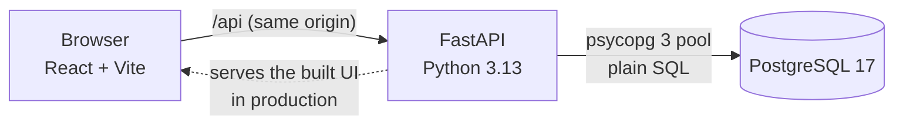
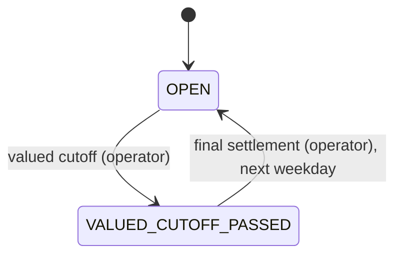

# Tokenized Treasury Transfer & Reconciliation Lab

An independent educational project: a small full-stack app that models how a book-entry security
can be converted into a tokenized form, moved between approved participants, converted back, and
reconciled, without ever creating or losing a unit. A second part adds the cash leg: a DTC-style
delivery-versus-payment (DVP) settlement engine with the two main settlement risk controls,
recycling, and an end-of-day net settlement.

> **Simulation only.** One invented instrument (`DEMO-TREASURY`), synthetic participants and
> settling banks, illustrative dollar figures and a public demo password. No real securities,
> money, blockchain or DTCC systems are involved: the "tokenized" form is a column in PostgreSQL,
> and the cash leg is a set of obligations in PostgreSQL rows (the "NSS file" is a table, not a
> Federal Reserve interface). The design is inspired by public descriptions of DTC's settlement
> service and of securities tokenization services; it is not affiliated with DTCC.

## What it does

An operations user can see where the security is held (traditional vs. tokenized units), convert
between the two forms, transfer tokenized units to another approved account, and prove that no
operation created or lost units.

The settlement engine (Lessons 11-14) adds valued deliveries: a participant delivers traditional
units against payment, the engine checks the delivery against the Collateral Monitor and the Net
Debit Cap, then settles it or recycles it until a later credit lets it through, and an operator
closes the day with one figure per participant and one net-net figure per settling bank. See
[Settlement engine](#settlement-engine-dvp-with-dtc-style-risk-controls).

**Demo flow** (tokenization; the numbers are the seed data):

1. Sign in as `alpha`: 1,000 traditional, 0 tokenized.
2. Convert 100 to tokenized (mint): 900 / 100.
3. Transfer 25 tokenized to `beta`: alpha 900 / 75, beta 1,000 / 25.
4. Convert 10 back to traditional (burn): alpha 910 / 65.
5. Open the history; try a rejected transfer (to the unapproved Delta wallet, or more than you hold);
   resend a request with the same idempotency key and see it replayed, not applied twice.
6. Sign in as `auditor` and run reconciliation: passed, still 3,000 units in total.

The settlement story has its own demo, an executable script that checks every number:
[The settlement demo](#the-settlement-demo).

**Demo users** (password `demo-password-1` for all, shown on the sign-in screen):

| User | Role | Account |
| --- | --- | --- |
| `alpha`, `beta`, `gamma` | Participant: acts only on their own account (convert, transfer, deliver orders, settlement progress payments) | 101, 102, 103 |
| `operator` | Operator, the simulated DTC settlement desk: runs the valued cutoff and final settlement and reads every account; cannot deliver, convert, transfer or run reconciliation (separation of duties) | none |
| `auditor` | Auditor: reads everything, changes nothing, runs reconciliation | none |

Account 104 (Delta) exists but its wallet is **not approved**, so it can never receive tokenized
units. It has no login, and its net debit cap is $0 (a lab choice so that Delta can never be
debited; DTC would apply its established minimum net debit cap), so a deliver order to Delta
always recycles.

**Screens:** participants see Holdings, Convert & transfer, Settlement (DVP), History and
Reconciliation (which explains that only the auditor can run it); the auditor sees Holdings,
Settlement (read-only), History and Reconciliation; the operator sees Settlement day, Holdings and
History. Each screen handles loading, empty, validation and server-error states.

## Architecture



- **Development:** Vite serves the UI on :5173 and proxies `/api` to FastAPI on :8000; Postgres runs
  in Docker.
- **Production:** one Docker image. A Node stage builds `client/dist`, and the Python stage serves
  both the API and the built UI from the same origin, so the session cookie needs no CORS setup.
- **No ORM.** Every SQL statement lives in `server/db/**/*.sql` as a named block (`-- name: ...`);
  Python loads them by name and never contains SQL text. Parameters are always sent separately
  (`%(name)s`), never pasted into the SQL.

### Data model

| Table | Purpose |
| --- | --- |
| `accounts` | Participants, their synthetic registered wallet (`is_approved`, deny by default) and their `settling_bank_id` |
| `assets` | The instrument and its `total_custodied_units` (3,000) |
| `users` | Login identity, bcrypt hash, role (`PARTICIPANT`, `AUDITOR` or `OPERATOR`); a participant links to exactly one account |
| `positions` | One row per account and asset: `traditional_units` and `tokenized_units`, both `>= 0` |
| `operations` | Every committed write request, plus the system's settlement events: actor, type, accounts, quantity, `amount_cents`, idempotency key, request hash, stored result |
| `ledger_entries` | The audit trail of units: signed deltas per account and form; every operation's lines sum to zero or to its opening amount |
| `settling_banks` | The two demo settling banks; each pays or is paid one net-net amount for all its participants |
| `settlement_day` | Exactly one row: business date, phase (`OPEN` / `VALUED_CUTOFF_PASSED`) and the maximum net debit cap. Also the settlement sequencer: every request that can settle or recycle a delivery locks it first |
| `collateral_prices` | Prior close and haircut per asset; `collateral_cents_per_unit` is a generated column, so the haircut arithmetic exists in one place |
| `net_debit_cap_inputs` | Per account: average of the 3 highest net-debit peaks and the factor (illustrative seed values) |
| `settlement_accounts` | Per account: net settlement balance, collateral value, net debit cap. Two `CHECK`s enforce the two risk controls |
| `delivery_instructions` | One row per deliver order: what was instructed, status (`SETTLED` / `RECYCLING` / `DROPPED_AT_CUTOFF`), recycle reason, its request and settlement operations |
| `cash_ledger_entries` | The money twin of `ledger_entries`: signed cents on a participant's settlement balance or on DTC's Fed account line (an end-of-day Fed line names its settling bank); every operation's lines sum to zero |
| `settlement_figures` | Each account's final net for every closed day |
| `nss_file_lines` | The simulated NSS file: one net-net line per settling bank for every closed day |

The migration runner adds one more table, `schema_migrations`, to record which files ran.

Foreign keys, `CHECK` rules (no negative balances, valid roles and types, one shape per operation
type, no self-transfer or self-delivery, both risk controls) and unique keys are enforced by the
database itself, not only by the app.

### How a transfer stays correct

One request = one database transaction on one connection:

1. Authenticate (signed session cookie) and authorize (participants only; the source account
   comes from the session, never from the request body).
2. Validate the body (whole units 1 to 1,000,000; unknown fields rejected).
3. Reserve the idempotency key: `INSERT ... ON CONFLICT DO NOTHING` on `(actor, key)`.
   A repeat with the same body replays the stored result (`200`, `Idempotency-Replayed: true`);
   the same key with a different body is a `409`.
4. Lock both position rows with `SELECT ... FOR UPDATE`, always in account-id order, so two
   opposite transfers cannot deadlock.
5. Check the source balance on the locked row, then that both wallets are approved (`422` if not).
6. Debit, credit, write the ledger lines, store the result, `COMMIT`. Any error rolls back all of it.

Conversions follow the same pattern on a single row. Since the settlement engine, a mint also
lowers the account's collateral value (tokenized units count $0 as collateral), and is refused
when that would make its Collateral Monitor negative; a burn adds the collateral back.

### Reconciliation

`GET /api/reconciliation` (auditor only) runs eight checks inside one `REPEATABLE READ, READ ONLY`
snapshot. Each row carries an `ok` computed in SQL; the report passes only if every row is ok.

1. **Conservation:** traditional + tokenized units across all accounts = `total_custodied_units`.
2. **Positions vs. ledger:** every stored balance (per account and form) = its opening allocation
   plus all committed ledger deltas. This catches a balance changed on the wrong account, which
   check 1 alone would miss.
3. **Cash lines net to zero:** every operation's cash ledger lines sum to zero.
4. **Settlement balance vs. cash ledger:** every account has a settlement account, and its stored
   net balance = the sum of its participant settlement lines (closed days net to zero).
5. **Collateral vs. positions:** every stored collateral value = traditional units x collateral
   per unit; tokenized units count zero (the no-action-letter rule, as a check).
6. **Settled instructions vs. ledgers:** every settled deliver order has its own DVP settlement
   operation with the same accounts, quantity and amount, and exactly its two unit lines and two
   cash lines; no settlement operation is unreferenced.
7. **Risk controls:** the settlement day exists, every cap = `LEAST(maximum, average peak x
   factor)`, every net >= -cap and every Collateral Monitor >= 0.
8. **Closed days:** for each closed day, the totals agree (settlement figures = NSS file = that
   day's settlement progress payments, and that day's lines on DTC's Fed account net to zero), and
   so does every line: each account's figure is what final settlement closed on its balance, and
   each settling bank's NSS line and closing Fed line equal the sum of the figures of the accounts
   it settles for. Totals alone would miss money shifted from one bank to another.

Checks 4, 5 and 7 start from `accounts`, so a missing settlement account (or a missing
`settlement_day` row) is a failing row, not a row that silently is not there.

Checks 1-2 cannot detect a wrong recipient that both the ledger and the balances recorded
consistently; that needs an independent record of the original instruction. For DVP this gap is
now partly closed: `delivery_instructions` is that record, and check 6 compares every settled
instruction with the ledger lines written for it. Tokenized transfers still have no such record.

### API

| Method and path | Who | Notes |
| --- | --- | --- |
| `POST /api/login`, `POST /api/logout`, `GET /api/me` | anyone / signed in | Session cookie: signed, HttpOnly, SameSite=Lax, Secure in production |
| `GET /api/holdings` | signed in | Participant: own account; auditor and operator: all |
| `GET /api/accounts` | signed in | Directory for the transfer and deliver forms (no balances) |
| `POST /api/conversions` | participant | `{direction, quantity, idempotencyKey}` |
| `POST /api/transfers` | participant | `{toAccountId, quantity, idempotencyKey}` |
| `POST /api/delivery-orders` | participant | `{toAccountId, quantity, amountCents, idempotencyKey}`: `201` settled, `202` recycling (with a reason); the deliverer is always the session account |
| `GET /api/delivery-orders` | signed in | Participant: orders it delivers or receives, counterparty reasons masked; auditor and operator: all, exact reasons. Newest first, at most 100 |
| `POST /api/settlement-progress-payments` | participant | `{amountCents, idempotencyKey}`: credits the payer's net balance, then retries the recycle queue |
| `GET /api/settlement/day` | signed in | Business date, phase, maximum net debit cap, collateral price and haircut |
| `GET /api/settlement/accounts` | signed in | Net, collateral, Collateral Monitor, cap, headroom. Participant: own row; auditor and operator: all |
| `POST /api/settlement-day/valued-cutoff` | operator | `{idempotencyKey}`: drops every recycling order, closes valued processing |
| `POST /api/settlement-day/final-settlement` | operator | `{idempotencyKey}`: figures, NSS file, nets to zero, opens the next business day |
| `GET /api/settlement/closed-days` | auditor, operator | The 10 most recent closed days: figures and NSS file |
| `GET /api/operations` | signed in | Participant: operations on its account; auditor and operator: all. Newest first, at most 100 |
| `GET /api/reconciliation` | auditor | All eight checks, one snapshot |
| `GET /api/health` | anyone | API and database status |

Money is always whole cents in fields named `...Cents` (JSON integers; `amountCents` 1 to
10,000,000,000,000). Errors are always `{"error": "..."}`: `400` invalid body (for example
`cannot deliver to yourself`), `401` not signed in, `403` wrong role, `409` key reused with a
different body, `413` body too large, `422` business rule (for example `insufficient tokenized
units`, `wallet is not approved`, `valued processing is closed: the valued cutoff has passed`,
`run the valued cutoff first`), `503` database unavailable: retry with the same idempotency key.
Interactive docs: `/api/docs`.

## Settlement engine (DVP with DTC-style risk controls)

The idea in one sentence: securities move one delivery at a time, in real time, but the money is
netted: each participant ends the day with one net figure, and each settling bank pays or is paid
one net-net amount at end of day (apart from settlement progress payments, Fed funds a participant
may wire in during the day). Because the securities leave before the money arrives, every valued
delivery must first pass two risk controls. The lessons: 11 the schema
(`migrations/004`), 12 deliver orders, the engine and settlement progress payments, 13 the
settlement day, 14 the settlement reads.

### What it models

| Concept | At DTC (public descriptions) | In this lab |
| --- | --- | --- |
| Valued delivery (DVP) | A deliver order moves securities against a settlement obligation | Traditional units move now; the deliverer's net settlement balance goes up by the amount, the receiver's goes down |
| Collateral Monitor (CM) | Collateral value + net settlement balance; must not go negative, for the deliverer or the receiver. Collateral = the prior day's close less a haircut of 2% to 100% | The same rule, with one price ($100.00 close, 5% haircut = $95.00 per traditional unit). Collateral moves with the units on every delivery, mint and burn |
| Net Debit Cap (NDC) | A net debit may not exceed the cap: the average of the 3 highest intraday net-debit peaks over a rolling 70 business days, times a factor between 1 and 2, capped at DTC's maximum NDC ($3.844B since 6 Apr 2026), not below DTC's established minimum NDC (twice the sum of all Participants' minimum Fund deposits); DTC may also limit any cap at its discretion. Affiliated families share an aggregate cap | `cap = LEAST(maximum, average x factor)` from inputs written into the seed (no 70-day history); no minimum net debit cap; no families |
| Recycling | Transactions that lack position or would breach the CM or NDC recycle (pend) | The order is stored `RECYCLING` with a reason and retried whenever a credit arrives; it settles if a credit makes room before the valued cutoff, otherwise it drops |
| Valued cutoff | Valued items still pending at about 3:10pm ET drop | An operator button: every recycling order becomes `DROPPED_AT_CUTOFF` |
| Settlement progress payment | A Fed funds wire that credits the CM and the settlement balance | A participant's payment credits its net balance and retries the queue; no money moves |
| End of day | Final figures about 3:45pm, one net-net figure per settling bank, the NSS file with the Fed about 4:30pm | An operator button: a figure per account, one NSS line per settling bank, every net to zero, the next weekday opens |
| Tokenized units | SEC staff no-action letter of 11 Dec 2025: DTC acts on a Tokenization Instruction only if it passes the CM and NDC, and tokenized entitlements get no collateral value | Tokenized units count $0; a mint that would make the CM negative is refused (a mint changes no net balance, so the cap cannot fail) |

DTC has a third primary risk control, the IPN collateral control, that this lab does not model.

### The settlement day



While `OPEN`, participants send deliver orders and settlement progress payments. After the valued
cutoff both are refused with `422` (a lab choice) until final settlement opens the next business
day (the next weekday; there is no holiday calendar).

### How a deliver order settles

One request = one database transaction, like a transfer:

1. Authenticate and authorize (participants only). The deliverer is the session account;
   delivering to yourself is a `400`.
2. Validate the body: whole units 1 to 1,000,000, whole cents 1 to 10,000,000,000,000.
3. Reserve the idempotency key (a `DELIVER_ORDER` operation: the request). An unknown receiver is
   a `422 unknown account` from its foreign key.
4. Lock, always in this one global order: the `settlement_day` row (the sequencer), then every
   position of the asset (by account id), then every settlement account (by account id); then
   read the collateral price. A retry may settle anyone's order, so the engine locks every row it
   might touch up front and never takes a lock out of order. With four accounts that is cheap; at
   DTC scale it would have to be partitioned (a lab simplification).
5. If the phase is not `OPEN`: `422 valued processing is closed: the valued cutoff has passed`.
6. Check the delivery in this order; the first failure is the recycle reason:

   | Check | Reason |
   | --- | --- |
   | The deliverer holds the traditional units | `INSUFFICIENT_POSITION` |
   | Deliverer's CM after: (collateral - units x price) + (net + amount) >= 0 | `DELIVERER_COLLATERAL_MONITOR` |
   | Receiver's CM after: (collateral + units x price) + (net - amount) >= 0 | `RECEIVER_COLLATERAL_MONITOR` |
   | Receiver's net after: net - amount >= -cap | `RECEIVER_NET_DEBIT_CAP` |

7. **Passes:** a system `DVP_SETTLEMENT` operation (the event) moves the units, and their
   collateral value, from the deliverer to the receiver, credits the deliverer's net and debits
   the receiver's, and writes two unit lines and two cash lines; the instruction is stored
   `SETTLED`; then the recycle queue is retried, because the credit may let waiting orders
   through. **Fails:** the instruction is stored `RECYCLING` with its reason, and nothing else
   changes.
8. Store the result, `COMMIT`: `201` settled or `202` recycling, with the deliverer's account
   state after the whole transaction and the ids of released orders it is a party to.

A replay (same key, same body) returns `200` with the body stored when the order was first
answered, even after the valued cutoff (the key is reserved before the phase check). The replay
is a record of that answer, not the order's current state: an order that first answered
`RECYCLING` and settled later still replays as `RECYCLING`. `GET /api/delivery-orders` shows the
current status.

**Retries** (a lab choice) happen only on credit events, a deliver order that settles or a
settlement progress payment: repeated passes over the queue, largest amount first, then by id
(oldest first), until a pass settles nothing. A waiting order's reason is kept current.

**Privacy** (a lab choice): a participant sees only the orders it delivers or receives, and a
reason about the other side only as `WAITING_ON_COUNTERPARTY`. In the demo, alpha's order to beta
shows alpha `WAITING_ON_COUNTERPARTY` while beta, the receiver, sees `RECEIVER_NET_DEBIT_CAP`.

**The database is the backstop.** The app checks both controls first, so it can recycle with a
clear reason; the `CHECK`s `settlement_within_net_debit_cap` and
`settlement_collateral_monitor_nonnegative` on `settlement_accounts` make a breach impossible to
commit even if the app's check were wrong (`422 net debit cap exceeded` /
`collateral monitor would go negative`). A settlement event's idempotency key is
`dvp-<order's operation id>`, unique with `NULLS NOT DISTINCT` on `(actor, key)` although the
system has no actor, so one order can never settle twice.

### End of day

- **Valued cutoff** (operator): locks the sequencer, turns every `RECYCLING` order into
  `DROPPED_AT_CUTOFF` (keeping its reason) and closes valued processing. A second cutoff the same
  day is a `422`.
- **Final settlement** (operator, only after the cutoff, else `422 run the valued cutoff first`):
  locks the sequencer and every settlement account; records each account's final net
  (`settlement_figures`) and one net-net line per settling bank (`nss_file_lines`: `+` the bank is
  paid, `-` the bank pays); posts closing cash lines (minus each net on the participants, plus
  each net-net on DTC's Fed account line, naming its settling bank) so the operation nets to zero;
  sets every net to zero; opens the next weekday.

Every settled delivery credits one participant exactly what it debits another, so the day's
figures sum to the day's settlement progress payments: money DTC already received during the day.

### The settlement demo

The story below is an executable script, `server/demo/settlement_scenario.py`. It drives the real
API over HTTP, signs in as `alpha`, `beta`, `gamma`, `operator` and `auditor`, performs every step
in order, checks every status code, reason, net, Collateral Monitor, figure and NSS line, and
prints a few lines per step (use it to rehearse the demo). It exits `1` at the first mismatch and
`2` if it cannot start; it refuses to run unless the database is freshly seeded, because every
number starts from the seed.

```bash
npm run db:reset           # deletes all local data: the demo needs a freshly seeded database
npm run dev                # in another terminal: the API on :8000
npm run demo:settlement    # or: uv run --directory server python -m demo.settlement_scenario
npm run demo:settlement -- --base-url http://127.0.0.1:8001   # another server
```

The seed (illustrative numbers, every dollar figure scaled down 1:100,000, so the $38,440.00
maximum cap stands for DTC's $3.844B):

| Account | Units | Collateral at $95.00 | Net debit cap | Settling bank |
| --- | --- | --- | --- | --- |
| 101 alpha | 1,000 | $95,000.00 | $38,440.00 ($32,000 x 1.25 = $40,000, capped at the maximum) | 201 Settling Bank One (demo) |
| 102 beta | 1,000 | $95,000.00 | $15,000.00 ($10,000 x 1.50) | 201 Settling Bank One (demo) |
| 103 gamma | 1,000 | $95,000.00 | $25,000.00 ($20,000 x 1.25) | 202 Settling Bank Two (demo) |
| 104 Delta | 0 | $0.00 | $0.00 (a lab choice so that Delta can never be debited; DTC would apply its established minimum NDC) | 202 Settling Bank Two (demo) |

The story (the API takes cents: $20,000.00 is `"amountCents": 2000000`):

| Step | Who | Action | Result | Why |
| --- | --- | --- | --- | --- |
| 1 | alpha | Deliver order #1: 200 units to beta for $20,000 | `202` recycling, `RECEIVER_NET_DEBIT_CAP` (alpha sees `WAITING_ON_COUNTERPARTY`) | Beta's net would be -$20,000, beyond its $15,000 cap. Nothing moved |
| 2 | beta | Deliver order #2: 100 units to gamma for $10,000 | `201` settled; the retry settles #1 in the same request (`releasedInstructionIds` holds #1: beta is its receiver) | Beta's +$10,000 credit makes room. Now alpha 800 units, net +$20,000; beta 1,100, -$10,000; gamma 1,100, -$10,000 |
| 3 | gamma | Mint 995, then 994 | `422 collateral monitor would go negative: tokenized units have no collateral value`, then `201` | CM would be 105 x $95 - $10,000 = -$25; with 994 it is 106 x $95 - $10,000 = $70 |
| 4 | alpha | #3: 100 units to gamma for $10,000; #4: 100 units to beta for $10,000 | Both `202`: `RECEIVER_COLLATERAL_MONITOR`, `RECEIVER_NET_DEBIT_CAP` | Gamma's CM would be 206 x $95 - $20,000 = -$430; beta's net would be -$20,000 |
| 5 | gamma | Settlement progress payment of $500 | `201`; the retry settles #3; #4 still recycling | Gamma's net is -$9,500, so its CM after #3 is 206 x $95 - $19,500 = $70 |
| 6 | operator | Valued cutoff, then final settlement | #4 `DROPPED_AT_CUTOFF`. Figures: alpha +$30,000, beta -$10,000, gamma -$19,500, Delta $0. NSS file: Bank One +$20,000, Bank Two -$19,500 | The NSS lines sum to +$500, gamma's payment. Every net becomes $0 and the next weekday opens |
| 7 | auditor | Reconciliation | Passed: all eight checks | Units still 3,000: alpha 700, beta 1,100, gamma 206 traditional + 994 tokenized |

### Lab choices and simplifications

These are deliberate choices of this lab, not DTC rules:

- Deliver orders and settlement progress payments are refused (`422`) after the valued cutoff.
- Recycle reasons about the counterparty are masked as `WAITING_ON_COUNTERPARTY`.
- Delta's net debit cap is $0, so it can never be debited (DTC would apply its established minimum
  net debit cap; this lab has no minimum).
- Retries happen only on credit events (a deliver order that settles, a settlement progress
  payment), largest amount first, then id.
- A mint that would make the CM negative is refused immediately (`422`), not pended.
- One sequencer row serializes every request that can settle or recycle a delivery, and every
  deliver order and settlement progress payment locks all positions and settlement accounts up
  front.
- The operator triggers the cutoff and final settlement by hand; there is no clock and no
  holiday calendar.

## Run it locally

Prerequisites: Node.js 22.12+, [uv](https://docs.astral.sh/uv/), Docker Desktop (running).

```bash
npm install                          # client and dev tooling
uv sync --directory server           # server/.venv with Python 3.13, the API and dev dependencies
cp server/.env.example server/.env   # then set SESSION_SECRET (the file shows how to generate one)
npm run db:up                        # Postgres in Docker, waits until healthy
npm run db:seed                      # migrations + synthetic demo data
npm run dev                          # API on :8000, UI on http://localhost:5173
```

| Command | What it does |
| --- | --- |
| `npm run db:psql` | Interactive SQL shell on the dev database |
| `npm run db:migrate` | Apply new files in `server/db/migrations/` (each runs once) |
| `npm run db:seed` | Migrations, then new files in `server/db/seeds/` |
| `npm run db:reset` | **Delete all local data**, recreate the database, migrate and seed |
| `npm run db:down` | Stop the database container (data is kept) |
| `npm test` | Rebuild the separate test database and run the whole API test suite |
| `npm run demo:settlement` | Run the settlement story against the running API (needs a freshly seeded database) |
| `npm run lint`, `npm run build` | Lint and build the client |

Try one named SQL block with values; it prints the result and always rolls back:

```bash
uv run --directory server python -m db.try_block queries/holdings.sql holdings_for_account account_id=101
```

`npm run dev` restarts the API whenever a `.py` file in `server/app/` or a `.sql` file in
`server/db/` is saved, so the running app always uses the latest SQL.

## Tests

`npm test` runs 667 tests against a **real PostgreSQL** database (`ttlab_test`, set by
`TEST_DATABASE_URL` in `server/.env`; the suite refuses to touch the dev database) and a real
uvicorn server. Nothing about database behaviour is mocked. `test_15_upgrade_path` also creates and
drops a scratch database, `ttlab_test_upgrade`, so the database user needs `CREATEDB`, the same
right `tests/reset_db.py` needs to rebuild `ttlab_test`.

The modules run in file-name order: up to `test_45` nothing changes a balance, so `test_50` can
check the exact lesson numbers; later modules assert relative changes.

| Module | Tests | What it proves |
| --- | ---: | --- |
| `test_05_risk_math` | 36 | The pure risk rules: every number of the settlement story, a Collateral Monitor of exactly zero passes, mint 994 passes and 995 fails, the four checks in their order |
| `test_10_runner` | 13 | Migrations apply once, in order; a broken migration leaves nothing behind; every table and every constraint by name, the operations columns, the generated collateral column and `NULLS NOT DISTINCT` |
| `test_15_upgrade_path` | 6 | On a scratch database: migrations and seeds 001-003 only, balances changed, then the real runner applies 004 and the starting collateral reflects the current positions |
| `test_20_constraints` | 119 | Every constraint attack (negative balances, bad roles, self-transfer, breached risk controls, wrong instruction or cash line shapes, ...) is rejected; the largest amount is accepted |
| `test_30_seeds` | 9 | Seed data, including the operator, the settling banks, the settlement day (the first weekday on or after the seed ran) and the starting collateral and caps |
| `test_40_auth_and_reads` | 17 | Login, sessions, the cookie flags, holdings and the account directory |
| `test_45_authorization` | 58 | Auditor never writes; the operator only runs the settlement day; participants act and read only for their own account; every endpoint needs a login; no request body can name another account; query parameters cannot widen a view |
| `test_50_demo_flow` | 50 | The demo flow end to end, replay, `409` on a changed body, every rejection with nothing persisted |
| `test_60_driver_boundary` | 230 | Each query file holds exactly the blocks the app needs; the psycopg rules the app relies on (named parameters, typed ints, `::bigint` sums, JSONB, row lookup); the engine's one global lock order |
| `test_70_atomicity` | 8 | An error or a killed connection after the debit leaves no trace; a 500 keeps the connection usable; fast recovery after a DB restart |
| `test_80_concurrency` | 14 | Two simultaneous transfers of 80 from 100 cannot both succeed; same-key duplicates apply once; no deadlocks |
| `test_85_reconciliation` | 26 | One snapshot for all checks; deliberate corruptions are detected, at least one for each settlement check and one for each part of checks 6 and 8 (money shifted between settling banks included); a missing settlement day or settlement account fails the report |
| `test_90_settlement` | 59 | Every settlement flow and message: settle, recycle, retry, privacy, payments, cutoff, final settlement, replay and `409`; the retry order, a reason kept current, a release that needs a second pass, the largest amount accepted, the next weekday from every day of the week |
| `test_92_settlement_safety` | 17 | Concurrent settlement requests, a delivery queued behind the cutoff, the lock order of mint and burn, crash drills, both database backstops, no order settles twice |
| `test_99_final` | 5 | After hundreds of concurrent operations the books still balance, every operation's cash lines net to zero, and the full report passes |

CI (`.github/workflows/ci.yml`) runs the suite against a Postgres service container, and lints and
builds the client, on every push to `main` and every pull request.

## Deploy (Render)

`render.yaml` is a Render Blueprint: one Docker web service plus one managed PostgreSQL 17.

1. In the Render dashboard: **New > Blueprint**, choose this repository, and apply.
2. Render builds the `Dockerfile`, generates `SESSION_SECRET`, and connects `DATABASE_URL` to the
   new database over the private network (the database accepts no internet connections).
3. On every start, `server/start.py` applies new migrations and, because `SEED_DEMO_DATA=true`,
   the demo data (each file only once), then serves the app on Render's `$PORT`.
4. Open the service URL and sign in with a demo user. `/api/health` is the health check.

An existing deployment upgrades in place: migration 004 adds the settlement tables, and seed 004
computes each account's starting collateral from the positions it finds at that moment. Seed 004
opens the first weekday on or after the day it runs, in the database's time zone (UTC by default).

Free Render instances sleep when idle and free databases expire; check
[Render's current free-tier limits](https://render.com/docs/free) before relying on a demo.

## Design decisions

- **PostgreSQL over a document store:** the guarantees here (foreign keys, `CHECK`s, row locks,
  transactions, snapshots) are relational-database features.
- **Plain SQL over an ORM:** locking, constraints and queries stay visible and reviewable.
- **Whole units as `INTEGER`, money as whole cents in `BIGINT`:** exact (no floating point),
  bounded, and safe as JSON numbers in the browser. Every `SUM` of cents is cast back to `bigint`,
  so an overflow fails loudly instead of returning a decimal.
- **Idempotency in the database:** a unique `(actor, key)` plus a request hash, so retries are
  safe even across app restarts or several app instances. `NULLS NOT DISTINCT` extends it to the
  system's own settlement events (`dvp-<id>`), so one order can never settle twice.
- **One global lock order:** the `settlement_day` sequencer, then positions by account id, then
  settlement accounts by account id. Transfers lock two positions in account order; mint and burn
  lock their own position, then their own settlement account (a subset in the same order). No
  request can deadlock another. Short transactions and `lock_timeout=5s` keep one stuck lock from
  stalling the API.
- **A sequencer row for the engine:** every request that can settle or recycle a delivery locks
  the one `settlement_day` row first, so the engine runs one step at a time, and the recycle queue
  is read only after that lock is held.
- **Recycle, don't reject:** a delivery that would breach a control is a normal state (`202` and
  a reason), settled later by a credit, not an error.
- **Request vs. event:** `DELIVER_ORDER` (the participant's request) and `DVP_SETTLEMENT` (the
  system's event) are separate operations, because a recycled order settles later, inside
  somebody else's request. `delivery_instructions` is the independent record of what was
  instructed, which reconciliation compares with the ledgers.
- **A separate cash ledger:** units and cents are different things, so cash lines live in
  `cash_ledger_entries`, and every operation's cash lines sum to zero.
- **Defense in depth:** the app validates for clear messages and clear recycle reasons; the
  database constraints are the guarantee (they stop a double spend or a risk-control breach even
  if the app check is bypassed).
- **One deployment for UI and API:** same-origin cookies and a simple deploy; the trade-off is
  that frontend and backend release together.

## Known limitations

- One database holds both forms, so this lab does not model keeping two separate ledgers (a
  custodian's books and a blockchain) in sync, or asynchronous reconciliation between them.
- Signed-cookie sessions are stateless: a cookie copied before logout stays valid until it
  expires (8 hours). A `users.session_version` column would close this.
- No login throttling. A public deployment should rate-limit `/api/login`.
- `422` bodies name the database constraint that fired, which is useful for learning and
  debugging; a production API would log that server-side and return only the message.
- Demo credentials are public and shared by all five users; the data is synthetic and resettable.
- The audit trail is append-only by application behaviour, not cryptographically immutable: a
  database administrator could still change rows.

**The settlement engine is a teaching model, not DTC:**

- **Venue:** most US Treasury DVP settlement runs over Fedwire Securities, not at DTC.
  `DEMO-TREASURY` stands in for any DTC-eligible security.
- **The cash leg is obligations only:** net balances, cash ledger lines and an "NSS file" table.
  No money moves, and no Federal Reserve, settling bank or wire is involved.
- **Illustrative numbers,** every dollar figure scaled down 1:100,000; the seed's peaks, factors
  and prices are invented.
- **The CM and NDC are simplified:** one asset, one price and haircut for the whole day, no
  intraday repricing; collateral here is only the haircut value of traditional positions; cap
  inputs are written into the seed instead of computed from 70 business days of peaks; no minimum
  net debit cap; no affiliated-family aggregate caps.
- **No RAD:** at DTC, valued deliver orders are subject to Receiver Authorized Delivery controls.
  A delivery within the receiver's RAD limits (DTC-established limits plus the receiver's own
  global or bilateral limits) is approved passively, one beyond them waits for the receiver's
  active approval, and from 3:00 to 3:20pm ET every valued transaction is forced into RAD. Here a
  deliver order goes straight to the risk checks.
- **No IPN collateral control,** DTC's third primary risk control.
- **No default management:** no participant ever fails to settle, so there is no failure
  handling, liquidity resource or loss allocation. DTC's liquidity is designed so that settlement
  completes even if the largest participant or affiliated family fails; none of that is modelled.
- **Tokenization:** the no-action letter's design (the Digital Omnibus Account, LedgerScan) is not
  modelled; only its two rules are (tokenized units have no collateral value, and a tokenization
  must pass the controls). Production tokenized trades ran on 15 Jul 2026 and DTC's Tokenization
  Service launch was scheduled for October 2026; this lab does not assume the service is live.

## Project structure

```
client/                 React + Vite UI (screens in src/components/)
server/app/             FastAPI app: routes/, domain/ (one function per flow), errors, settings
server/db/migrations/   numbered schema files, each applied once
server/db/seeds/        synthetic demo data
server/db/queries/      the named SQL blocks the app runs
server/db/migrate.py    the migration runner; runner-bookkeeping.sql holds its SQL
server/demo/            executable demo scenarios (npm run demo:settlement)
server/tests/           pytest suite against real PostgreSQL
Dockerfile, render.yaml production image and Render Blueprint
```
